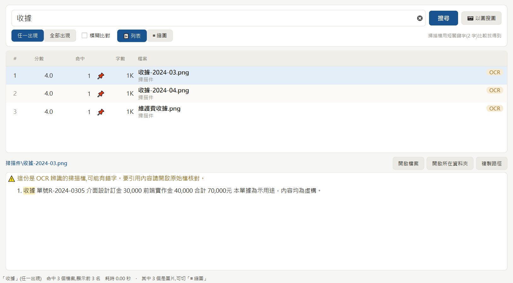

# findpile

**把一個塞了幾千幾萬份檔案的資料夾,變成搜得到的東西。**

完全離線。你的檔案內容不會離開這台電腦,不呼叫任何 API,沒有帳號,沒有雲端。

```
python findpile.py --root D:/文件 index     掃一次,建索引
python findpile.py find 報價                 查
```


> 真正的報價單排在前面(命中 8 次、檔名也中),大檔案裡剛好提過幾次的
> 排在後面。下半部直接給你命中的段落,不用開檔就知道是不是這一份。
>
> **本頁所有截圖的資料都是虛構的示範檔**,公司名、金額、日期都是編的。

---

## 這是為了什麼做的

Windows 的搜尋找得到**檔名**,找不到**內容**。於是會變成這樣:

> 「我記得那個報價單裡寫過一個數字…… 在哪個資料夾?」

然後開始一個一個點開來看。幾千份檔案,這招就廢了。

findpile 做三件事:

| | |
|---|---|
| **讀得進去** | Word、PDF、Excel、PowerPoint、純文字、HTML、ODF,連 1997 年的 `.doc` 二進位格式都抽得出字 |
| **讀得懂掃描件** | 掃描的 PDF 和照片裡的字,用 OCR 辨識進同一個索引 |
| **排得對** | 關鍵字真正的「主題檔案」浮上來,不是出現次數最多的那份(見下面的排名公式) |

加上一個桌面視窗,和一套以圖搜圖。

## 這和 Everything / AnyTXT 差在哪

說實話的版本:

| | Everything | AnyTXT | findpile |
|---|---|---|---|
| 檔名搜尋 | **無敵快** | 有 | 有 |
| 內文搜尋 | 沒有 | 有 | 有 |
| 掃描件 OCR | 沒有 | 沒有 | **有** |
| 影片／音檔 | 找得到檔名 | 找得到檔名 | 找得到檔名,另開一區 |
| 以圖搜圖 | 沒有 | 沒有 | **有** |
| 排名邏輯 | — | 一般 | 可讀、可改、寫在這份文件裡 |
| 成熟度 | 非常高 | 高 | 一個人寫的 |

**如果你只要找檔名,去裝 Everything,它比這個好。**

findpile 值得裝的情況只有一個:**你有一堆掃描件或照片,裡面的字搜不到**。
那是上面兩個工具都不做的事,而且對很多人來說,那剛好是最難找的那一半檔案。



> 這三筆是 **PNG 圖檔**。OCR 之後和 Word、PDF 躺在同一個索引裡,一起排名。
> 右邊的 `OCR` 標籤和上方的黃色警告都是程式自己標的。
>
> 順帶一提:截圖裡那句「前端實作**金** 40,000」原本是「前端實作**訂金**」——
> 這是這次示範 OCR 真的辨錯的字,沒有修掉。**這正是為什麼要開原始檔核對。**

圖片結果可以切成縮圖牆,一眼掃完:


---

## 安裝

需要 Python 3.9 以上。

```bash
git clone https://github.com/chia397777/findpile.git
cd findpile
pip install pymupdf pypdf python-docx openpyxl
```

上面四個是「讀得進檔案」的最低需求。其餘按需要加:

```bash
pip install PySide6                      新介面視窗(強烈建議)
pip install opencv-python pillow numpy   以圖搜圖
pip install rapidocr-onnxruntime opencc-python-reimplemented   掃描件 OCR
pip install pillow-heif                  iPhone 的 .heic 照片
```

不裝 PySide6 也能用 —— 會自動退回內建 Tkinter 的舊視窗,功能一樣。

### macOS

雙擊 `安裝.command`,它會自己找一個堪用的 python3、裝好套件、建索引。
找不到 python3 的話先雙擊 `安裝Python.command`。

## 開始用

**1. 建索引**(只做一次,之後只更新有變動的檔案)

```bash
python findpile.py --root D:/你的文件 index
```

每次都要打 `--root` 很煩的話,複製 `config.example.json` 成 `config.json`,把
`scan_root` 設好就不用了。

> 不給 `--root` 又沒有 `config.json` 時,程式會**拒絕執行**並告訴你為什麼 ——
> 預設值會是磁碟根目錄,那等於掃整顆硬碟。

**2. 查**

```bash
python findpile.py find 報價                      單一關鍵字
python findpile.py find 報價 估價                 任一出現
python findpile.py find 會議 紀錄 --mode all      兩個都要出現
python findpile.py find 報價 --fuzzy              容錯比對(查掃描件時用)
python findpile.py stats                          看索引狀態
```

**3. 開視窗**

| | |
|---|---|
| Windows | 雙擊 `搜尋視窗_新介面.bat` |
| macOS | 雙擊 `開啟搜尋_新介面.command` |

Windows 還有一個 `查.bat`,可以 `查 報價` 直接搜。

**4. 掃描件 OCR**(選用,很花時間但可以中斷續跑)

```bash
python findpile.py ocr --scope .          辨識 root 底下所有圖片
python findpile.py ocr --scope pdf        辨識抽不出文字的 PDF
```

Windows 可以雙擊 `OCR全跑.bat`。幾千張圖要跑幾小時,但隨時 Ctrl+C 中斷,
下次執行會從中斷處接續,不會重做。

**5. 以圖搜圖**(選用)

```bash
python findpile.py imgindex               建立圖片特徵庫
python findpile.py findimg 某張照片.jpg   找相同／相似的圖
```

視窗裡可以直接把圖**拖進去**,或 `Ctrl+V` 貼上。

---

## 設計:排名公式為什麼長這樣

這是整個工具最有意思的一行:

```python
kb    = max(nchars / 1024, 1.0)
score = total / (kb ** 0.75) + nmatch * 3.0
```

`total` 是命中次數,`nchars` 是這個檔案的字數,`nmatch` 是有幾個關鍵字出現在檔名裡。

### 為什麼要除以字數

因為**純算次數會排出完全沒用的結果**。

假設你查「報價」:

| 檔案 | 字數 | 命中 | 純算次數 | 除以字數後 |
|---|---|---|---|---|
| 報價單-甲公司.txt | 1K | 4 | 第 2 名 | **第 1 名** ✅ |
| 一本 2MB 的參考書 | 2000K | 58 | 第 1 名 ❌ | 第 N 名 |

那本書裡「報價」出現 58 次,但它**不是在談你要找的報價**。
1K 的報價單出現 4 次,它整份都是。你要的是後者。

### 為什麼是 0.75 次方,不是 1

除以 `kb` 的**一次方**(= 算密度)會過度補償,把短檔案全推到最前面 ——
一個只有 20 個字、剛好提到一次的便利貼,密度高得嚇人。

`0.75` 是個折衷:大檔案要被壓,但不要壓到「長文件永遠出不來」。
這個數字是調出來的,不是推導出來的。想改就改,它就在那一行。

### 檔名命中為什麼是固定加 3 分,不是乘

檔名命中是**強烈的意圖訊號** —— 一份檔案叫「報價單」,幾乎可以確定它就是。
但如果用乘法,它會和字數互動:短檔案的檔名加成會被放大到不合理。
固定加分讓它穩定地「往前推一個級距」,不會失控。

`nmatch * 3.0` 的意思是「每個命中的關鍵字加 3 分」,所以查兩個詞、
檔名都中,就加 6 分 —— 這通常足以讓它穩居第一。

### 已知的瑕疵(誠實版)

`max(nchars / 1024, 1.0)` 的那個 `1.0` 是個**地板**。
1KB 以下的檔案一律當成 1KB,所以 200 字和 20 字的檔案除以同一個數。
理論上這讓極短檔案的排名偏低。

實際量過:在作者自己的資料堆(約 15,000 份檔案)上跑 8 組真實查詢,
**被這個地板影響到、又真的該出現在前 10 名的檔案:0 個**。

原因是極短檔案本來就幾乎不可能命中足夠次數擠進前 10。
所以這個瑕疵存在,但沒有症狀 —— 留著,也寫在這裡,免得有人以為沒注意到。

---

## 設計:索引過期會自己說

索引是一份快照,不會自己更新。實際撞到的情形:存了一份新的 Word,
到視窗裡搜尋,找不到,以為程式壞了。

**加一個「更新索引」按鈕只解決一半** —— 它解決「知道要更新之後怎麼更新」,
不解決「不知道索引是舊的」。而按鈕沒有人會沒事去按。

所以先量成本:

```
走訪 24,593 個檔案、逐筆 stat 並比對,耗時 1.7 秒(每秒 14,116 個)
```

便宜到可以自動做。於是:

* **開窗時查一次**,**視窗重新取得焦點時再查一次**(存完檔切回來就知道)。
  60 秒內不重複查 —— 視窗切來切去會發很多次 `WindowActivate`。
* 有待更新的檔案時,按鈕變成 **`⟳ 更新索引 (3)`** 並轉成琥珀色,
  滑鼠提示直接寫「現在搜不到它們」。
* 按下去在背景掃,**掃的是索引裡記錄的 roots,不是設定檔的 `scan_root`**——
  「更新」的語意是「把已經收錄的範圍再看一次」。索引可能是用 `--root`
  指到別處建的,拿 `scan_root` 去掃會掃到不相干的地方。
* 掃完自動重讀索引,而且**把目前的搜尋重跑一次** —— 剛收進來的檔案要
  立刻看得到,不然使用者會以為沒更新到。

### 三個實作細節

**不走 `_run()`。** 那條路會在結束時呼叫 `busy(False)` 把搜尋按鈕打開;
如果使用者正在搜尋,按鈕會在搜尋還沒回來之前就先亮起來。背景雜務不該碰
介面的忙碌狀態,所以過期檢查自己開一條 `Task`。

**`cmd_index` 是印到 stdout 的命令列函式。** 與其為了介面改寫它,不如把
`sys.stdout` 接走 —— 它印的每一行本來就是給人看的進度,逐行轉成 signal
送到狀態列剛好。

**按鈕變色用 `setProperty("stale", True)` + `unpolish/polish`,**
不是換 `styleSheet` 字串。換字串會讓整個樣式表重算,整個視窗閃一下。

### 開窗就自動更新,不用按按鈕

按鈕還是在,但預設不需要用到:**開窗後那次檢查如果發現有東西沒收進來,
就自己跑一次**。

幾個刻意的取捨:

* **只在開窗後第一次跑。** 視窗每次重新取得焦點都會再查一次,但那只是
  為了把按鈕點亮。如果每次回到視窗都自動寫入,使用者會在完全沒預期的
  時候看到進度跑來跑去,而且常常正是他要搜尋的那一刻。
* **沒變動就完全不跑。** 開窗的成本就只有那 1.7 秒的背景比對,零寫入。
* **自動那次不鎖搜尋按鈕。** 使用者開窗就是要查東西,不該為了背景雜務
  等它;手動按的那次才鎖,因為那是他主動要的動作。
* **根目錄掛不上就整個不做。** 外接碟沒插、網路碟沒連的時候,那底下的
  紀錄不可以被當成「檔案不見了」。`reindex()` 先用 `os.path.isdir()`
  濾過 roots,濾完是空的就直接返回。
* 不想要的話,`config.json` 設 `"auto_index": false`。

### 順手抓到的一個真 bug

原本是在背景執行緒裡把 `sys.stdout` 換掉,用來攔截 `cmd_index` 的輸出。
**`sys.stdout` 是全域的** —— 背景執行緒換掉它,主執行緒同一時間印的東西
也會一起被吃掉。

這個在視窗上看不出來(沒有人在看終端機),是跑測試時發現輸出少了好幾節
才抓到的。改法:`cmd_index(args, say=None)`,`say` 預設是 `print`,
視窗版傳一個把每行轉成 signal 的 callable 進去。函式裡 16 個 `print`
全部改成 `say`。

教訓:**為了攔輸出而動全域狀態,代價會跑到你沒想到的地方去。**

---

## 設計:依類型與時間篩選

查一個常見詞會得到兩千多筆。那時候缺的不是更準的排名,是
**「只看 PDF」** 或 **「只看今年」**。

搜尋列底下多一排:

```
類型 [PDF (693) ▾]    時間 [不限 ▾]    排序 [最新在前 ▾]     篩選後 693 / 2,115 筆
```

表格也多一個日期欄。三個選單都是在記憶體裡篩現有結果,不重查資料庫,
所以是即時的 —— 查詢本身要 0.5 秒,篩選幾乎不花時間。

**類型選單只列這批結果裡真的有的類型,而且帶筆數。** 固定列出八個類型
沒有用:查到 2,124 筆的時候,人想知道的是「裡面有 693 個 PDF」,
不是「有沒有簡報這個選項」。

類型分組寫在 `KINDS`,視窗版和命令列共用同一份 —— 副檔名太細了
(`.docx` / `.doc` / `.odt` 其實是同一回事),而且兩邊各有一套說法遲早
會對不起來。

命令列同樣:

```bash
python findpile.py find 報價 --kind PDF --since 2024-01-01 --sort new
```

```
篩選(類型=PDF、自 2024-01-01):2,124 筆 -> 14 筆
```

報告檔的表格也加了日期欄 —— 既然可以依時間篩選,就得看得到時間。

### 兩個實作上的雷

原本表格的檔案欄寫死在索引 4。插進日期欄之後,全檔要找出「哪個 4 是
欄位編號、哪個 4 是別的東西」—— 那種錯不會在編譯時被抓到,只會在執行
時丟 `NoneType is not subscriptable`。所以改成 `COLS` / `DATECOL` /
`NAMECOL` 三個常數,測試裡寫死的欄位編號也一起換掉。

`_rebuild_kinds()` 換選單內容時要 `blockSignals` —— 換內容會觸發
`currentIndexChanged`,不擋的話每搜尋一次就多跑一輪篩選,而且跑的是
半成品狀態。這和填表格要擋訊號是同一個坑(見下面的 PySide6 那節)。

---

## 設計:抽不出內文的檔案怎麼辦

影片、音檔、還沒 OCR 的圖片 —— 這些檔案沒有內文可以搜。
但**它們的檔名和資料夾名稱本身就是線索**:

```
2024尾牙/開場表演.mp4
客戶會議錄音/0312議價錄音.m4a
```

「尾牙」「議價」「錄音」都寫在路徑上了。

所以 `index` 會多收一類 `src='name'` 的紀錄:只記路徑、大小、時間,
不抽內文。在作者的資料堆上加了 9,540 筆,**索引檔一個位元組都沒變大**
——SQLite 把刪除留下的空頁填回去了。

同時這裡修掉一個一直都在的洞:**資料夾名稱以前完全不在搜尋範圍內**。
比對寫成 `kw in os.path.basename(p)`,路徑其餘部分整段丟掉。測試庫裡
有 5,559 筆在同一個資料夾底下,拿那個資料夾名去查卻只有 6 筆(還是
內文剛好提到)。資料夾名稱的資訊量很高,丟掉等於丟掉一半線索。

### 為什麼分兩區,而不是混在一起排

「有內文」和「只有名稱」的性質不一樣。名稱紀錄 `nchars=0`,分數只能
靠名字湊,混排的話沒內文的紀錄會把文件稀釋掉 —— 查一個相簿資料夾名
會一次噴出幾千張照片,把真正的文件壓到看不見。


> 介面上多一組切換鈕「📄 有內文 / 🏷 只有名稱 2」。文件區空的、名稱區
> 有東西時會自動切過去 —— 不然畫面是空的,看起來像查不到,其實旁邊
> 按鈕裡有東西。名稱區整批都是圖片時直接開縮圖牆。
>
> 那一區的欄位換成「類型 / 命中在檔名還是資料夾 / 檔案大小」。
> 寫「命中 0 次、1K 字」只會讓人以為搜尋壞了。

資料夾名稱命中只加 **0.5 分**,刻意比檔名的 3 分低很多,理由同上。

### 兩個實作上的陷阱

**OCR 紀錄不可以被名稱紀錄蓋掉。** 圖片兩邊都會碰到:`index` 想記名字,
`ocr` 想寫辨識出來的內文。所以 `index` 只在「這筆不存在」或「這筆本來
就是 `name`」時才寫。測試裡有一項專門改掉 mtime 逼 `index` 重新處理,
確認內文還在 —— 不然一次 `index` 就會把幾小時的辨識成果清空。

**檔案大小上限只能管要抽內文的檔。** `MAX_BYTES` 是 80 MB,影片動輒
一兩百 MB,照舊規則擋下去等於又把整批影片排除在外。

### 排除編譯產物,以及「改了排除規則要能生效」

作者的 Mac 上索引了 3,853 個檔案,其中 **2,888 個是 `.json`** —— 全部在
一個 Flutter 專案的 `build/.../merged_res_blame_folder/` 底下,是 Gradle 的
資源合併記錄檔。佔整個索引四分之三,而真正的 `.docx` 只有 339 個。

所以 `SKIP_DIRS` 預設含 `build`、`Pods`、`DerivedData`。
`.gradle`、`.dart_tool`、`.idea`、`.next` 不必列 —— 以 `.` 開頭的資料夾
本來就一律跳過。

**但光加排除清單沒有用。** 前面那個「磁碟上真的不存在才刪」的條件,
會讓舊紀錄永遠留著:build 底下的檔案都還在,只是不該再收了。
所以清除條件是兩個理由任一成立:

```python
and (not os.path.exists(p) or _is_skipped(p, root))
```

`_is_skipped()` 和 `walk()` 共用同一個 `_skip_dir()`。兩邊各寫一份條件的話,
「掃描時跳過」和「舊紀錄要清掉」遲早會對不起來 —— 那種 bug 只會表現成
「索引裡有一些查得到但永遠掃不到的幽靈紀錄」。

真的有一個叫 `build` 的資料夾要收,`config.json` 寫
`"keep_dirs": ["build"]`;要再排除別的寫 `"skip_dirs": [...]`。

### 效率:索引多了 63%,搜尋反而變快

索引從 15,057 筆變成 24,597 筆(240 MB)。量完才發現擔心錯方向 ——
成本不在筆數,在**每次搜尋都要把整個內文欄 LIKE 掃一遍**。新紀錄
`nchars=0`、`text IS NULL`,幾乎不佔掃描成本。

順手修掉兩個一直都在的浪費:

1. **內文被讀了兩遍。** 原本先 `SELECT path ... WHERE text LIKE ?`,
   再對每個候選 `SELECT text ... WHERE path=?`。第一趟已經把整個 text
   讀過了。改成第一趟就帶回來,常見字省掉 0.3 秒。
2. **`os.path.basename(p)` 對每一列呼叫一次。** 改成先用 `kw in p` 篩
   (這正好就是「連資料夾名稱一起比對」要做的事),survivor 才拆檔名。
   `kw in p` **快 50 倍**:0.001 秒 vs 0.05 秒。修正那個洞和提升效能
   是同一件事。
3. **`PRAGMA mmap_size`。** 讓作業系統直接映射檔案,少一層複製。
   LIKE 掃描 0.60 → 0.46 秒。`cache_size` 加大沒用(0.60 → 0.57)。

| 查(2 字中文) | 改之前 15,057 筆 | 改之後 24,597 筆 |
|---|---|---|
| 一般詞 | 0.82 秒 | 0.56 秒 |
| 很常見的字 | 0.99 秒 | 0.57 秒 |

---

## dupimg —— 找出完全重複的圖片

以圖搜圖的副產品。特徵庫裡本來就有每張圖的 pHash,距離 0 就是同一張圖
(縮放、重新壓縮、改檔名都認得出來),拿 pHash 當 dict 的鍵分組,
一萬多張幾秒跑完,不必兩兩比對。

```bash
python findpile.py imgindex    # 先建特徵庫
python findpile.py dupimg
```

作者自己的資料堆跑出來:13,713 張裡有 **2,153 組重複、2,369 張多餘副本、
2.7 GB**。

**只收距離 0。** 距離 1~5 是「看起來很像」,那是 `findimg` 在做的事 ——
拿來當刪檔依據太危險:連拍的兩張、同一張圖的不同裁切都落在那個範圍。

### 這個指令不會刪任何東西

報告每組列出「建議保留」和「其餘副本」。保留的挑法:先比畫素(同一張圖
可能有不同解析度的版本),再比檔案大小(同尺寸時壓得少的畫質較好),
最後比路徑長度 —— 路徑短的通常是原始位置,深的多半是備份或匯出。

每一行都印出尺寸。少了那個數字就無從判斷「刪掉的是不是比較好的那張」。

報告開頭另外列「重複最集中的資料夾配對」—— 整批整理的單位是資料夾,
不是單張圖。

刪幾 GB 的照片不該由程式自己按下去,所以這裡只產清單。

---

## 設計:以圖搜圖的三層

以圖搜圖不是一件事,是四個不同的問題。findpile 做前三個:

| 層 | 問的問題 | 用什麼 | 狀態 |
|---|---|---|---|
| 1 | 這**就是**同一張圖嗎?(改了檔名、重壓過、縮放過) | pHash,64-bit 感知雜湊 | ✅ |
| 2 | 這是**同一個東西/場景**嗎?(不同角度拍同一份文件、同一個招牌) | ORB 特徵點 + RANSAC 幾何驗證 | ✅ |
| 3 | 圖**裡面的字**是什麼? | OCR,結果併進關鍵字索引 | ✅ |
| 4 | 這是**「海邊」「寵物」**這類**語意**嗎? | CLIP 類模型 | ❌ 不做,理由見下 |

### 為什麼結果會標 ✓ 和 ?

第 2 層的 ORB 只能說「這兩張圖有 N 個特徵點對得上」。這個數字單獨看會**錯得很慘**
—— 實測不同文件之間誤判率 67%。所以它只當篩子,真正的判斷交給 RANSAC:

把對上的點拿去解一個幾何變換(平移、旋轉、縮放)。如果這些點**真的來自同一個場景**,
它們的位移會一致,解得出來;如果只是巧合,點的位移東一塊西一塊,解不出來。

- **✓ 相符** = 通過幾何驗證,可以相信
- **?** = 特徵點對上了但幾何驗證沒過,自己看一眼

這個區別很重要。一個不告訴你「我有多確定」的搜尋結果,等於要你全部重看一遍。


> 右邊那張是左邊那張**轉了 11 度、縮到 82%、裁掉邊緣、還調亮過**的版本。
> ORB 找到 206 個吻合點,幾何驗證通過 → 標 ✓。
> 這張截圖是真的跑一次深度搜尋產生的,不是排出來的。

### 為什麼不做第 4 層(語意)

ORB 比對的是**同一個物理點**在兩張圖裡的位置。
兩張不同的海邊照片,共同的可重複特徵點是 **0 個 —— 不是少,是結構上不存在**。
所以第 4 層不是「把門檻調鬆一點」就能做到的,它需要完全不同的模型(CLIP / MobileCLIP)。

技術上做得到,而且**規模根本不是問題**:13,700 張圖 × 512 維 float16 ≈ 14 MB,
一個 numpy 陣列裝得下,不需要向量資料庫。擋住它的是效益,不是技術 ——
詳見下面「評估過但決定不做的」。

---

## 隱私:這個設計的前提

**你的檔案內容不會離開這台電腦。** 這不是承諾,是結構:

- 沒有任何網路呼叫。抽文字、OCR、以圖搜圖全部在本機跑
- OCR 用的是本機的 ONNX 模型,不是雲端 API
- 沒有帳號、沒有遙測、沒有「使用狀況回報」

但有一件事要**你自己注意**:

> ### ⚠️ `index.db` 裡是你所有檔案的全文
>
> 它不是索引摘要,是**完整內文**。所以:
>
> - `.gitignore` 已經擋掉 `*.db` 和 `reports/`。**不要解除**
> - 不要把 `index.db` 丟到雲端硬碟、不要寄給人、不要放進公開倉庫
> - 要搬到另一台電腦,用 USB 或區域網路直接複製(`pack` 指令會幫你打包)
>
> 這個工具唯一可能洩漏資料的途徑就是你自己把 `index.db` 搬出去。

### OCR 的文字只能用來「找」,不能用來「引用」

OCR 會錯字。數字、人名、專有名詞特別容易錯。

findpile 的定位是**帶你找到那個檔案**,不是取代原始檔。
找到之後請開原始檔確認,再引用裡面的任何內容。

---

## 踩過的坑(寫給下一個用 PySide6 做這種工具的人)

這一節沒有一條是從文件讀來的,全部是撞牆撞出來的。

**1. `QPixmap` 不能在工作執行緒碰。**
縮圖牆有幾百張圖,同步讀會卡住畫面好幾秒,所以丟到 `QThreadPool`。
但 `QPixmap` 背後接的是繪圖裝置,Qt 明文規定只能在主執行緒用。
在 Windows 的 raster 後端上**目前不會當掉** —— 那是未定義行為,不是「可以這樣寫」。
正確做法:工作執行緒只產 `QImage`(執行緒安全),signal 送回主執行緒再轉 `QPixmap`。

**2. 快速鍵的優先權高於按鍵事件。**
把 `Return` 掛在視窗上當「開啟檔案」,結果在搜尋框裡按 Enter 會變成開檔而不是搜尋 ——
快速鍵先攔走了。`Ctrl+C` 同理,會搶掉前後文面板的複製。
解法:掛在表格/縮圖牆上並設 `setContext(Qt.WidgetShortcut)`,只在那個元件有焦點時生效。

**3. `setHorizontalHeaderLabels` 會把標題項目整個重建。**
「檔案欄標題置左」只在建介面時設一次,第一次搜尋完就被蓋回置中
(欄位很寬,置中的標題會飄到畫面正中央,看起來不知道在標什麼)。
所以換標題這件事要收進一個函式,置左每次重套。

**4. 換結果時,舊的縮圖項目還指著舊清單。**
每個縮圖存了「這是第幾筆」。切換結果時清單已經換成新的 2 筆,
但 Qt 清除舊項目的過程中會把「正在被刪掉的那個」當成當前選取發出
`itemSelectionChanged`,拿它存的第 200 筆去索引就 `IndexError`。
取當前項目的函式一定要查邊界。另外填表期間要 `blockSignals` ——
填 300 列會白跑 300 次回呼,而且中途的狀態是半成品。

**5. 縮圖要墊成正方形,說明文字才會對齊。**
橫幅圖縮成 150x100、直幅 100x150,Qt 緊接著圖的下緣畫文字,
整面縮圖牆的文字就高高低低。墊進 150x150 的透明方框置中之後才齊。

另外兩件小事:`app.setStyle("Fusion")` 一定要設,不然 Windows 用原生樣式繪製,
QSS 裡的圓角和 padding 有一半會被蓋掉;`QImageReader` 要開 `setAutoTransform(True)`,
手機照片的 EXIF 旋轉才會跟著轉,不然橫拍的照片在縮圖牆裡全部躺著。

### macOS 特有的

- **不要用 `ln -s` 做桌面捷徑。** 啟動腳本裡有 `cd "$(dirname "$0")"`,
  走符號連結時 `$0` 會變成連結本身的路徑,`cd` 到桌面去,然後找不到程式。
  用一個兩行的包裝腳本:`cd ~/專案位置 && exec ./開啟搜尋_新介面.command`
- **`git pull` 下來的檔案沒有 Gatekeeper 隔離屬性**,雙擊 `.command` 可以直接跑。
  隔離屬性只有瀏覽器下載才會掛上。(作者原本以為會被擋,實測沒有。)
- **`git` 會保留 `mode 100755`**,所以 clone 下來不用 `chmod`。
  但用 USB(exFAT/FAT32)搬就會掉,那時要補 `chmod +x *.command`
- **macOS 的 Qt offscreen 平台會列舉系統字型**(走 CoreText,印得出 PingFang TC),
  Windows 的 offscreen **不會**,只拿得到 `Sans Serif`。
  所以字型相關的檢查在 Windows 上要用真平台跑

## 測試

```bash
python test_app.py              關鍵字自動從你的索引裡挑一個
python test_app.py 報價          指定關鍵字
```

72 項離屏煙霧測試。重點是它會呼叫 `widget.grab()` **強制重繪**,
所以自訂的兩行繪製、縮圖縮放都會真的被執行,不是只驗「物件建起來了」。

沒有索引、或沒有圖片特徵庫時會**講清楚原因然後正常結束**,不會假裝失敗。

---

## 評估過但決定不做的

寫這一節是因為:網路上滿地都是「我用 X 做了 Y」,幾乎沒有人寫
「我量了之後決定不做 X,這是數字」。後者對讀者有用得多。

以下每一條都附作者實際量到的數字(約 15,000 份檔案、13,700 張圖的資料堆)。
**如果你要重新評估,請重跑量測,不要直接信這些數字** —— 它們是 2026-10 的狀態,
而且是作者的資料,不是你的。

### ❌ 第四層:CLIP / MobileCLIP 語意搜尋

| 量到的 | 數字 |
|---|---|
| OCR 之後**還是完全沒有文字**的圖 | 479 張(佔 3.2%) |
| 靠 OCR 就搜得到的圖 | 91.8% |

也就是說,CLIP 的目標族群只有 3.2%。
為了那 3.2% 要加一個 ONNX 模型、一套向量比對、一個新的 UI 概念。

更麻煩的是**它和現有的 UI 衝突**:第 2 層能給你 ✓/? 的確定性判斷,
CLIP 只能給「相似度排名」—— 它永遠排得出前 10 名,就算對的答案不在裡面。
把「只能排序、不能判斷」的結果和「能判斷」的結果放在同一個清單裡,
會讓使用者對整個工具的信任度下降。

**規模不是障礙**(13,700 × 512 float16 ≈ 14 MB)。擋住它的是效益。

### ❌ FTS5 全文索引(加速搜尋)

每次搜尋都要把整個內文欄 LIKE 掃一遍,240 MB 的索引大約 0.5 秒。
SQLite 的 FTS5 可以把它降到 0.001 秒,拿 1,500 份文件的樣本實測確實
是這個數量級。**但它對中文沒用。**

中文沒有空白,FTS5 預設的 tokenizer 切不出詞,唯一能做子字串比對的是
`trigram` —— 而 trigram **只吃 3 個字以上的查詢**。同一個樣本庫:

```
MATCH「抵押權」(3 字)  ->  114 筆
MATCH「繼承」  (2 字)  ->    0 筆
MATCH「債務」  (2 字)  ->    0 筆
```

中文常用詞大半是兩個字。這不是調參數能解決的,是 tokenizer 的設計前提。
附帶一提成本:外推全庫索引約 **2.6 GB**(整個 `index.db` 才 240 MB),
建一次約 4 分鐘。

所以 LIKE 全表掃描留著。0.5 秒在互動上可以接受,為了它換來一個查不到
兩字詞的搜尋程式不划算。日文、韓文同理;英文等有空白的語言不受這個
限制,要改 FTS5 是合理的。

---

### ❌ 修排名公式的地板

就是上面那個 `max(nchars/1024, 1.0)`。
8 組真實查詢、每組前 10 名 = 80 個位置,**受影響的:0 個(0%)**。

修一個沒有症狀的瑕疵,代價是動到排序 —— 所有既有的使用習慣會跟著變。不划算。

### ❌ OCR 那些手機截圖

作者的資料堆裡有 2,018 張手機截圖沒做 OCR。

> **這裡記一個作者自己的推論錯誤,因為它值得記。**
>
> 第一版的理由是「截圖 OCR 之後會洗版」,舉證是「一張 5 次命中的截圖
> 贏過 215 筆結果裡的 184 筆」。數字是對的,**推論是錯的** ——
> 那 184 筆是長尾弱命中,**根本沒有人會看到它們**。
>
> 改量「第 10 名的門檻」才看清真相:門檻是 4.35~56.43 分,
> 需要 5~57 次命中才擠得進去。截圖**進不來**。
>
> 結論不變,但理由從「會變糟」改成「不會變好」。
> **教訓:看排名要用門檻判斷,不要用「贏過幾筆」。**

### ❌ 手機 App(iOS / Android)

查過市場,這塊**已經有人做完了**,而且是開源的:

- **Queryable**(iOS,開源)—— 用 CLIP 搜 iPhone 相簿
- **PicQuery**(Android,開源,MobileCLIP2)—— 支援中文查詢

自己再寫一個,要處理兩個平台的相簿權限、模型轉換、上架審核,
換來的是一個比現成品差的東西。沒有道理。

### 什麼情況下該把這些重新拉回來評估

1. 沒有文字的圖從 3.2% 變成 20% 以上(例如開始大量存風景照)
2. 出現一個「能給出確定性判斷、不只給排名」的語意模型
3. OCR 覆蓋率從 91.8% 掉下來
4. 真的開始有第二個使用者,而他的資料分佈和作者完全不同
5. 想把它變成產品(那整套取捨都要重算 —— 現在這些取捨的前提是「自己用」)
6. 索引超過 1 GB、或單次搜尋超過 2 秒(那時候的解法應該是自己建
   二字組倒排索引,不是 FTS5)

---

## 檔案結構

```
findpile.py                  核心:索引、搜尋、OCR、排名。命令列入口
app.py                       搜尋視窗(新,PySide6)
gui.py                       搜尋視窗(舊,Tkinter;不裝 PySide6 時的退路)
imgfind.py                   以圖搜圖引擎(pHash + ORB + RANSAC)
test_app.py                  離屏煙霧測試(72 項)

config.example.json          設定檔範本。複製成 config.json 再改
_pick_python.sh              macOS:挑一個堪用的 python3
docs/                        README 用的截圖

搜尋視窗_新介面.bat          Windows 啟動器(新介面,失敗自動退回舊的)
搜尋視窗.bat                 Windows 啟動器(舊介面)
查.bat                       Windows 命令列捷徑:查 報價
OCR全跑.bat                  Windows:批次 OCR

安裝.command                 macOS:一鍵安裝 + 建索引
安裝Python.command           macOS:沒有 python3 時先跑這個
開啟搜尋_新介面.command      macOS 啟動器(新介面)
開啟搜尋.command             macOS 啟動器(舊介面)
建立Mac索引.command          macOS:建索引
```

`gui.py`(舊介面)**刻意留著**。Qt 壞掉的時候(顯卡驅動、缺 DLL、換了直譯器)
舊視窗照樣能搜 —— 一個搜尋工具最不該發生的事就是「打不開」。

## 授權

MIT。拿去改、拿去用、拿去放進你的東西裡都可以。

沒有任何保證。這是一個人為了自己的需求寫的工具,不是產品。

## 這份文件為什麼這麼囉嗦

因為程式本身不難,難的是**那些判斷**:為什麼是 0.75 次方、
為什麼檔名用加法不用乘法、為什麼不做 CLIP、為什麼舊介面不刪。

程式碼可以自己讀,這些判斷讀不出來。所以寫下來。
